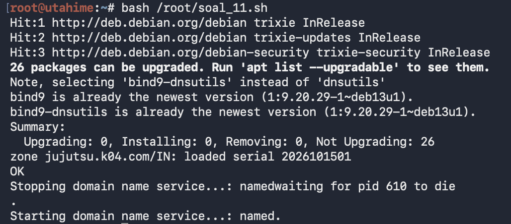
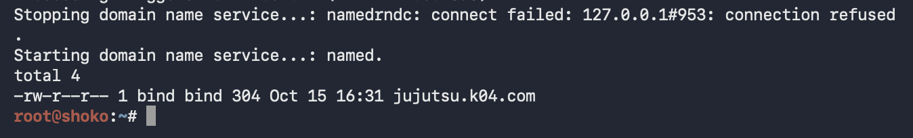
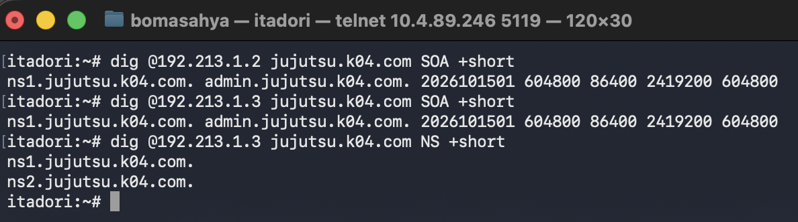
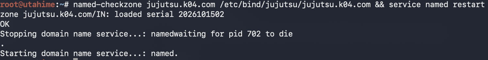
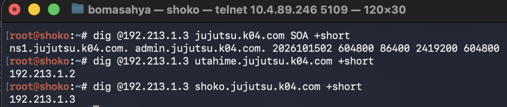
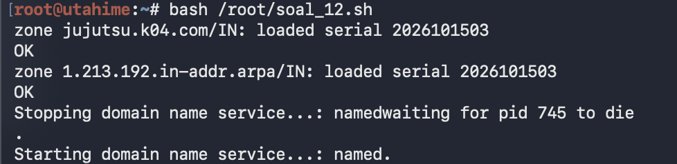
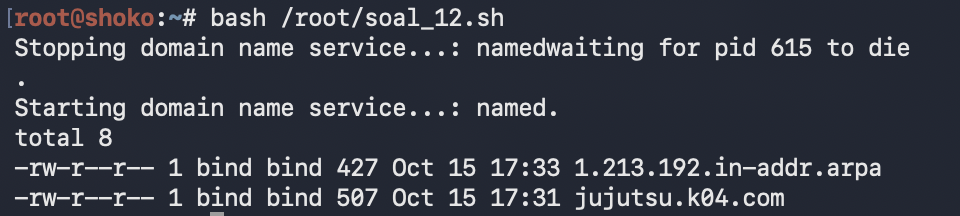
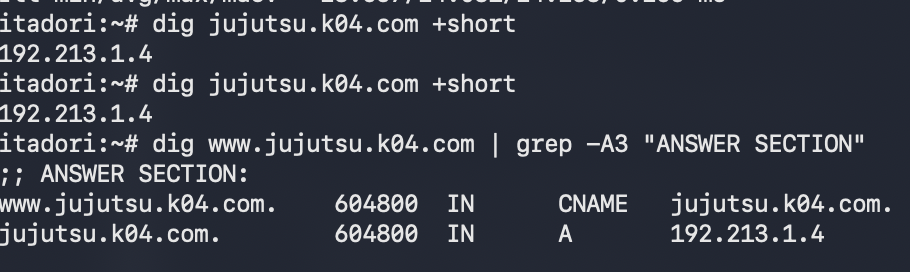
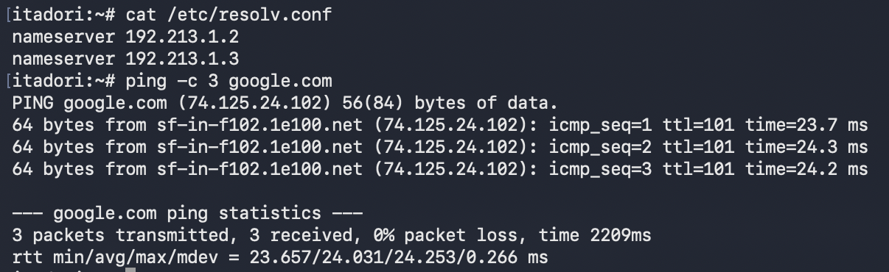

# PRAKTIKUM JARKOM MODUL 3 KELOMPOK 04 - 2026

## Anggota Kelompok
| Nama | NRP |
| :--- | :--- |
| Albert Chen | 5027251034 |
| Boma Sahya Aryaguna | 5027251125 |

---

## Topologi Jaringan & Pembagian Wilayah

Infrastruktur jaringan Jujutsu High terbagi menjadi 4 segmen wilayah di bawah kendali router utama **jichi** yang terhubung ke Internet/NAT:


> **Penjelasan Topologi:**
> Gambar di atas menunjukkan topologi jaringan praktikum di lingkungan GNS3. Router utama `jichi` bertindak sebagai pusat penghubung (gateway) yang memiliki interface `eth0` menuju NAT1 (Internet 192.168.122.0/24). Interface `eth1` mengarah ke Network 1 (DMZ) melalui Switch 1 yang berisi server `utahime`, `shoko`, dan `gojo`. Interface `eth2` mengarah ke Network 2 (Divisi A) melalui Switch 2, Switch 3 (`itadori`, `fushiguro`), dan Switch 9 (`zenin`, `okkotsu`). Interface `eth3` mengarah ke Network 3 (Divisi B) melalui Switch 4, Switch 5 (`ino`, `kusakabe`), dan Switch 8 (`kugisaki`, `miwa`). Interface `eth4` mengarah ke Network 4 (Data Center) melalui Switch 6, Switch 7 (load balancer `geto` dan worker `maki`, `panda`, `nanami`, `todo`, `kirara`), dan Switch 10 (DHCP server `tengen` serta database `yaga`, `inumaki`).

### Pembagian Wilayah:
* **Gateway & WAN**:
  * `jichi`: Router Utama & DHCP Relay (`eth0` ke NAT `192.168.122.0/24`).
* **Network 1 - DMZ (`192.213.1.0/24`)**:
  * Terhubung ke `jichi` melalui interface `eth1` (`192.213.1.1`).
  * `utahime` (`192.213.1.2`): DNS Master
  * `shoko` (`192.213.1.3`): DNS Slave
  * `gojo` (`192.213.1.4`): Public Reverse Proxy (Nginx)
* **Network 2 - Klien Divisi A (`192.213.2.0/24`)**:
  * Terhubung ke `jichi` melalui interface `eth2` (`192.213.2.1`).
  * Switch 3 (Pool 1): `itadori`, `fushiguro`
  * Switch 9 (Pool 2): `zenin`, `okkotsu`
* **Network 3 - Klien Divisi B (`192.213.3.0/24`)**:
  * Terhubung ke `jichi` melalui interface `eth3` (`192.213.3.1`).
  * Switch 5 (Short Lease): `ino`, `kusakabe`
  * Switch 8 (Long Lease & Fixed IP): `kugisaki` (Fixed IP), `miwa` (Long Lease)
* **Network 4 - Data Center Jujutsu High (`192.213.4.0/24`)**:
  * Terhubung ke `jichi` melalui interface `eth4` (`192.213.4.1`).
  * Switch 10:
    * `tengen` (`192.213.4.10`): DHCP Server
    * `yaga` (`192.213.4.51`): Database Master MariaDB
    * `inumaki` (`192.213.4.52`): Database Slave MariaDB
  * Switch 7:
    * `geto` (`192.213.4.20`): Internal Load Balancer (Nginx)
    * `maki` (`192.213.4.31`), `panda` (`192.213.4.32`): Worker Frontend
    * `nanami` (`192.213.4.41`), `todo` (`192.213.4.42`): Worker API Utama
    * `kirara` (`192.213.4.43`): Worker API Cadangan

---

## Tabel Pengalamatan IP (Addressing Table)

Prefix Kelompok: `192.213.X.X`

| Node | Interface | IP Address | Netmask | Gateway | Keterangan / Peran |
| :--- | :--- | :--- | :--- | :--- | :--- |
| **jichi** | `eth0`<br>`eth1`<br>`eth2`<br>`eth3`<br>`eth4` | `192.168.122.100/24`<br>`192.213.1.1/24`<br>`192.213.2.1/24`<br>`192.213.3.1/24`<br>`192.213.4.1/24` | `255.255.255.0` | `192.168.122.1`<br>-<br>-<br>-<br>- | Router Gateway, Source NAT, DHCP Relay Agent |
| **utahime** | `eth0` | `192.213.1.2/24` | `255.255.255.0` | `192.213.1.1` | Static - DNS Master |
| **shoko** | `eth0` | `192.213.1.3/24` | `255.255.255.0` | `192.213.1.1` | Static - DNS Slave |
| **gojo** | `eth0` | `192.213.1.4/24` | `255.255.255.0` | `192.213.1.1` | Static - Public Reverse Proxy (Nginx) |
| **tengen** | `eth0` | `192.213.4.10/24` | `255.255.255.0` | `192.213.4.1` | Static - DHCP Server ISC |
| **geto** | `eth0` | `192.213.4.20/24` | `255.255.255.0` | `192.213.4.1` | Static - Internal Load Balancer |
| **maki** | `eth0` | `192.213.4.31/24` | `255.255.255.0` | `192.213.4.1` | Static - Worker Frontend 1 |
| **panda** | `eth0` | `192.213.4.32/24` | `255.255.255.0` | `192.213.4.1` | Static - Worker Frontend 2 |
| **nanami** | `eth0` | `192.213.4.41/24` | `255.255.255.0` | `192.213.4.1` | Static - Worker API Utama 1 |
| **todo** | `eth0` | `192.213.4.42/24` | `255.255.255.0` | `192.213.4.1` | Static - Worker API Utama 2 |
| **kirara** | `eth0` | `192.213.4.43/24` | `255.255.255.0` | `192.213.4.1` | Static - Worker API Cadangan |
| **yaga** | `eth0` | `192.213.4.51/24` | `255.255.255.0` | `192.213.4.1` | Static - Database Master MariaDB |
| **inumaki** | `eth0` | `192.213.4.52/24` | `255.255.255.0` | `192.213.4.1` | Static - Database Slave MariaDB |
| **itadori** | `eth0` | Dynamic (`192.213.2.10`) | `255.255.255.0` | `192.213.2.1` | DHCP Client (Pool 1 Divisi A) |
| **fushiguro** | `eth0` | Dynamic (`192.213.2.11`) | `255.255.255.0` | `192.213.2.1` | DHCP Client (Pool 1 Divisi A) |
| **zenin** | `eth0` | Dynamic (`192.213.2.70`) | `255.255.255.0` | `192.213.2.1` | DHCP Client (Pool 2 Divisi A) |
| **okkotsu** | `eth0` | Dynamic (`192.213.2.71`) | `255.255.255.0` | `192.213.2.1` | DHCP Client (Pool 2 Divisi A) |
| **ino** | `eth0` | Dynamic (`192.213.3.11`) | `255.255.255.0` | `192.213.3.1` | DHCP Client (Short Lease 30m) |
| **kusakabe** | `eth0` | Dynamic (`192.213.3.12`) | `255.255.255.0` | `192.213.3.1` | DHCP Client (Short Lease 30m) |
| **kugisaki** | `eth0` | Static Lease (`192.213.3.99`) | `255.255.255.0` | `192.213.3.1` | DHCP Fixed Lease via MAC Address |
| **miwa** | `eth0` | Dynamic (`192.213.3.100`) | `255.255.255.0` | `192.213.3.1` | DHCP Client (Long Lease 12j) |

---

## Soal 1: Pemulihan Konektivitas Dasar & Routing Gateway

### Penyampaian Ulang Soal
Ketika Curtain menutup Shibuya, jalur komunikasi antar zona Jujutsu High terputus. Pulihkan konektivitas dasar dengan mengonfigurasi `jichi`: `eth0` memperoleh WAN dari NAT, sedangkan `eth1`–`eth4` menjadi gateway Network 1–4 sesuai tabel pemetaan. Aktifkan IPv4 forwarding dan source NAT, lalu tetapkan IP statis host infrastruktur sesuai tabel spesifikasi. Buktikan konektivitas setiap host ke gateway dan akses eksternal dari host yang relevan.

### Maksud Soal
Tujuan soal ini adalah membangun fondasi routing dan konektivitas dasar:
1. Router `jichi` harus menghubungkan seluruh 4 jaringan internal ke WAN/Internet lewat NAT.
2. Setiap node server/infrastruktur diberikan konfigurasi IP statis, default gateway, serta nameserver awal (`192.168.122.1`) agar dapat mengunduh paket software yang dibutuhkan.
3. Seluruh script konfigurasi diletakkan di `/root/` dan dipanggil otomatis melalui `/root/.bashrc` agar persisten saat reboot.

### Cara Mengerjakan

#### 1. Konfigurasi Router Gateway (`jichi`)
Membuat script `/root/jichi.sh`:
```bash
cat > /root/jichi.sh <<'EOF'
#!/bin/bash
P=192.213

# eth0 ke NAT GNS3 (192.168.122.0/24)
ifup eth0 2>/dev/null
if ! ip -4 addr show dev eth0 | grep -q "inet "; then
    ip addr add 192.168.122.100/24 dev eth0 2>/dev/null
    ip link set eth0 up
    ip route replace default via 192.168.122.1
fi

# Gateway Network 1-4
for n in 1 2 3 4; do
    ip link set eth$n up
    ip addr replace $P.$n.1/24 dev eth$n
done

# Routing IPv4 Forwarding + Source NAT (MASQUERADE)
sysctl -w net.ipv4.ip_forward=1 >/dev/null
iptables -t nat -C POSTROUTING -o eth0 -j MASQUERADE 2>/dev/null || \
iptables -t nat -A POSTROUTING -o eth0 -j MASQUERADE

echo "nameserver 192.168.122.1" > /etc/resolv.conf
EOF
chmod +x /root/jichi.sh
grep -q "/root/jichi.sh" /root/.bashrc || echo "bash /root/jichi.sh" >> /root/.bashrc
bash /root/jichi.sh
which iptables >/dev/null || apt-get install -y iptables
```

#### 2. Konfigurasi Node Statis di Network 1
* **utahime (`192.213.1.2`)**:
```bash
cat > /root/utahime.sh <<'EOF'
#!/bin/bash
P=192.213
ip link set eth0 up
ip addr replace $P.1.2/24 dev eth0
ip route replace default via $P.1.1
echo "nameserver 192.168.122.1" > /etc/resolv.conf
EOF
chmod +x /root/utahime.sh
grep -q "/root/utahime.sh" /root/.bashrc || echo "bash /root/utahime.sh" >> /root/.bashrc
bash /root/utahime.sh
```

* **shoko (`192.213.1.3`)**:
```bash
cat > /root/shoko.sh <<'EOF'
#!/bin/bash
P=192.213
ip link set eth0 up
ip addr replace $P.1.3/24 dev eth0
ip route replace default via $P.1.1
echo "nameserver 192.168.122.1" > /etc/resolv.conf
EOF
chmod +x /root/shoko.sh
grep -q "/root/shoko.sh" /root/.bashrc || echo "bash /root/shoko.sh" >> /root/.bashrc
bash /root/shoko.sh
```

* **gojo (`192.213.1.4`)**:
```bash
cat > /root/gojo.sh <<'EOF'
#!/bin/bash
P=192.213
ip link set eth0 up
ip addr replace $P.1.4/24 dev eth0
ip route replace default via $P.1.1
echo "nameserver 192.168.122.1" > /etc/resolv.conf
EOF
chmod +x /root/gojo.sh
grep -q "/root/gojo.sh" /root/.bashrc || echo "bash /root/gojo.sh" >> /root/.bashrc
bash /root/gojo.sh
```

#### 3. Konfigurasi Node Statis di Network 4 (Data Center)
* **tengen (`192.213.4.10`)**:
```bash
cat > /root/tengen.sh <<'EOF'
#!/bin/bash
P=192.213
ip link set eth0 up
ip addr replace $P.4.10/24 dev eth0
ip route replace default via $P.4.1
echo "nameserver 192.168.122.1" > /etc/resolv.conf
EOF
chmod +x /root/tengen.sh
grep -q "/root/tengen.sh" /root/.bashrc || echo "bash /root/tengen.sh" >> /root/.bashrc
bash /root/tengen.sh
```
* Node lainnya di Network 4 (`geto`: `.4.20`, `maki`: `.4.31`, `panda`: `.4.32`, `nanami`: `.4.41`, `todo`: `.4.42`, `kirara`: `.4.43`, `yaga`: `.4.51`, `inumaki`: `.4.52`) dikonfigurasi dengan script statis serupa mengarah ke gateway `192.213.4.1`.

### Cara Melakukan Validasi
1. **Verifikasi jichi**:
   * Menjalankan `ip -br a` untuk melihat IP seluruh interface, cek parameter `net.ipv4.ip_forward` (harus bernilai `1`), cek aturan iptables NAT `iptables -t nat -S POSTROUTING` (memastikan aturan MASQUERADE terpasang), serta tes koneksi internet `ping 8.8.8.8 -c 2`.
     
     
     
     Menampilkan daftar interface `jichi` dengan alamat IP yang sesuai (`eth0` ke WAN 192.168.122.100, `eth1`–`eth4` ke 192.213.1.1 s/d 192.213.4.1), parameter `net.ipv4.ip_forward = 1`, aturan iptables `-A POSTROUTING -o eth0 -j MASQUERADE`, serta hasil ping berhasil ke `8.8.8.8`.

   * Tes koneksi internet domain dan resolusi DNS: `ping google.com -c 3`.
     
     
     
     Menunjukkan router `jichi` berhasil melakukan ping ke domain publik `google.com` dengan packet loss 0%, serta isi berkas `/etc/resolv.conf` telah diarahkan ke nameserver NAT GNS3 (`192.168.122.1`).

3. **Verifikasi Host Infrastruktur**:
   * Di `utahime`, lakukan tes ping ke gateway (`192.213.1.1`), Google DNS (`8.8.8.8`), dan domain (`google.com`).
     
     
     
     Menunjukkan node DMZ `utahime` memiliki IP statis `192.213.1.2/24` dengan default gateway `192.213.1.1`. Tes ping berturut-turut ke gateway lokal (`192.213.1.1`), DNS eksternal (`8.8.8.8`), dan domain `google.com` seluruhnya sukses dengan 0% packet loss.

   * Di `gojo`, lakukan verifikasi `ip a` dan `ping google.com -c 2`.
     
     
     
     Menampilkan node `gojo` berhasil melakukan resolusi DNS dan ping ke `google.com`, serta verifikasi antarmuka jaringan menunjukkan interface `eth0` terkonfigurasi dengan alamat IP statis `192.213.1.4/24`.

---

## Soal 2: Konfigurasi DHCP Server di Data Center (Tengen)

### Penyampaian Ulang Soal
Tengen, penjaga pusat distribusi di Data Center, harus mengambil alih pengalokasian alamat bagi wilayah yang membutuhkan konfigurasi dinamis. Konfigurasikan `isc-dhcp-server` pada `192.213.4.10`. Deklarasikan Network 4 (`192.213.4.0/24`) sebagai subnet lokal tanpa pool dinamis, lalu siapkan scope DHCP untuk Network 2 (`192.213.2.0/24`) dan Network 3 (`192.213.3.0/24`). Validasi konfigurasi dan pastikan service aktif tanpa error “No subnet declaration”.

### Maksud Soal
Tujuan soal ini adalah mengonfigurasi ISC DHCP Server pada `tengen`:
1. Mencegah error `No subnet declaration for eth0` dengan mendeklarasikan subnet lokal Network 4 (`192.213.4.0/24`) tempat interface DHCP server berada, namun **tanpa** range dinamis (karena host di Network 4 ber-IP statis).
2. Menyiapkan blok scope subnet untuk Network 2 dan Network 3 yang nantinya akan menerima permintaan dari relay agent.
3. Menetapkan interface layanan ke `eth0`.

### Cara Mengerjakan
1. **Instalasi Paket & Interface**:
```bash
apt-get update -y && apt-get install -y isc-dhcp-server
sed -i 's/^INTERFACESv4=.*/INTERFACESv4="eth0"/' /etc/default/isc-dhcp-server
```

2. **Konfigurasi `/etc/dhcp/dhcpd.conf`**:
```nginx
authoritative;
default-lease-time 600;
max-lease-time 7200;

option domain-name-servers 192.213.1.2, 192.213.1.3;
option domain-search "K04.com";

# Network 4 (lokal DHCP server) -- TANPA dynamic range
subnet 192.213.4.0 netmask 255.255.255.0 {
    option routers 192.213.4.1;
}

# Scope Network 2 (Client Subnet 2)
subnet 192.213.2.0 netmask 255.255.255.0 {
    option routers 192.213.2.1;
    option subnet-mask 255.255.255.0;
    option broadcast-address 192.213.2.255;
}

# Scope Network 3 (Client Subnet 3)
subnet 192.213.3.0 netmask 255.255.255.0 {
    option routers 192.213.3.1;
    option subnet-mask 255.255.255.0;
    option broadcast-address 192.213.3.255;
}
```

3. **Uji Validasi Sintaks dan Start Service**:
```bash
touch /var/lib/dhcp/dhcpd.leases
dhcpd -t -cf /etc/dhcp/dhcpd.conf
service isc-dhcp-server restart
```

### Cara Melakukan Validasi
* Instalasi paket `isc-dhcp-server` dan setting interface `eth0` di `/etc/default/isc-dhcp-server`:
  
  
  Proses eksekusi `apt-get install -y isc-dhcp-server` pada `tengen` serta konfigurasi interface pendengar `INTERFACESv4="eth0"` pada berkas `/etc/default/isc-dhcp-server`.

* Periksa isi `/etc/dhcp/dhcpd.conf` dan restart service:
  
  
  
  Menampilkan berkas konfigurasi `/etc/dhcp/dhcpd.conf` di `tengen` yang telah mendeklarasikan subnet lokal Network 4 tanpa range, subnet Network 2, dan subnet Network 3, diikuti perintah restart dan status service yang menunjukkan `dhcpd is running`.

* Uji validasi sintaks dengan `dhcpd -t -cf /etc/dhcp/dhcpd.conf` dan verifikasi service restart:
  
  
  
  Pengujian berkas konfigurasi menggunakan `dhcpd -t -cf /etc/dhcp/dhcpd.conf` yang mengonfirmasi konfigurasi valid, pembuatan database `/var/lib/dhcp/dhcpd.leases`, serta service `isc-dhcp-server` yang berhasil di-restart dengan status aktif (`running`).

* Verifikasi IP `192.213.4.10` dan proses `dhcpd` yang berjalan di background:
  
  
  
  Verifikasi alamat IP interface `eth0` `192.213.4.10/24` pada node `tengen`, serta output `ps aux | grep dhcp` yang membuktikan daemon `dhcpd -cf /etc/dhcp/dhcpd.conf eth0` aktif berjalan di background.

---

## Soal 3: Konfigurasi DHCP Relay Agent (Jichi)

### Penyampaian Ulang Soal
Permintaan alamat dari Divisi A dan Divisi B tidak dapat menyeberangi subnet secara langsung. Konfigurasikan `jichi` sebagai DHCP Relay menuju `tengen` (`192.213.4.10`), menggunakan `eth2` untuk Network 2 dan `eth3` untuk Network 3. Buktikan bahwa client dari kedua subnet berhasil memperoleh lease melalui relay.

### Maksud Soal
Karena broadcast DHCP (Layer 2) tidak dapat melewati router secara default, node `jichi` difungsikan sebagai DHCP Relay Agent (`isc-dhcp-relay`) untuk mendengarkan broadcast di `eth2` (Network 2) dan `eth3` (Network 3), lalu meneruskannya secara unicast ke server `tengen` di Network 4 (`eth4`).

### Cara Mengerjakan
1. **Instalasi DHCP Relay di Router `jichi`**:
```bash
apt-get update -y && apt-get install -y isc-dhcp-relay
```

2. **Konfigurasi `/etc/default/isc-dhcp-relay`**:
```bash
SERVERS="192.213.4.10"
INTERFACES="eth2 eth3 eth4"
OPTIONS=""
```

3. **Menjalankan Service**:
```bash
service isc-dhcp-relay restart
service isc-dhcp-relay status
```

### Cara Melakukan Validasi
* Konfigurasi `/etc/default/isc-dhcp-relay` di `jichi` dan pemeriksaan lease awal:
  
  
  Menampilkan pembagian jendela: di sisi kiri berkas `/var/lib/dhcp/dhcpd.leases` pada `tengen`, dan di sisi kanan konfigurasi `/etc/default/isc-dhcp-relay` pada `jichi` dengan parameter `SERVERS="192.213.4.10"` dan `INTERFACES="eth2 eth3 eth4"` saat di-restart.

* Memastikan binding upstream dan downstream relay agent pada interface yang ditentukan:
  
  
  
  Log output eksekusi restart layanan `isc-dhcp-relay` di `jichi` yang memperlihatkan binding relay agent ke interface `eth2`, `eth3`, dan `eth4` baik sebagai upstream maupun downstream.

* Verifikasi antarmuka jaringan `jichi`, routing, sysctl forwarding, dan proses background `dhcrelay`:
  
  
  
  Terminal `jichi` menunjukkan informasi antarmuka `ip -br a`, tabel routing, parameter `net.ipv4.ip_forward = 1`, serta proses `dhcrelay -i eth2 -i eth3 -i eth4 192.213.4.10` yang berjalan aktif.

---

## Soal 4: Pemisahan Pool Dinamis Divisi A (Network 2)

### Penyampaian Ulang Soal
Agar tim Dev dan Support di Divisi A menerima jatah alamat yang berbeda, atur dua pool DHCP pada Network 2. Tetapkan Pool 1 (`192.213.2.10`–`192.213.2.35`) untuk `itadori` dan `fushiguro`, serta Pool 2 (`192.213.2.70`–`192.213.2.95`) untuk `zenin` dan `okkotsu`. Rentang `192.213.2.36`–`192.213.2.69` tidak boleh dialokasikan. Karena seluruh client berada pada subnet yang sama, gunakan DHCP class berdasarkan MAC Address atau Client ID untuk memisahkan kedua kelompok.

### Maksud Soal
Menerapkan klasifikasi DHCP (`class` dan `match if`) pada ISC DHCP server agar klien yang berada di broadcast domain / subnet yang sama (Network 2) dapat dipisahkan ke dalam pool alokasi IP yang berbeda berdasarkan identitas hardware (MAC address).

### Cara Mengerjakan
1. Identifikasi MAC address interface `eth0` masing-masing klien:
   * `itadori`: `02:42:cc:ae:66:00`
   * `fushiguro`: `02:42:c6:f6:d9:00`
   * `zenin`: `02:42:c3:a7:7e:00`
   * `okkotsu`: `02:42:d1:aa:fb:00`

2. Konfigurasi Class dan Pool di `/etc/dhcp/dhcpd.conf` pada `tengen`:
```nginx
class "divisi-a-pool1" {
    match if (
        binary-to-ascii(11, 8, ":", hardware) = "1:02:42:cc:ae:66:00" or
        binary-to-ascii(11, 8, ":", hardware) = "1:02:42:c6:f6:d9:00"
    );
}

class "divisi-a-pool2" {
    match if (
        binary-to-ascii(11, 8, ":", hardware) = "1:02:42:c3:a7:7e:00" or
        binary-to-ascii(11, 8, ":", hardware) = "1:02:42:d1:aa:fb:00"
    );
}

subnet 192.213.2.0 netmask 255.255.255.0 {
    option routers 192.213.2.1;
    option subnet-mask 255.255.255.0;
    option broadcast-address 192.213.2.255;

    pool {
        allow members of "divisi-a-pool1";
        range 192.213.2.10 192.213.2.35;
    }

    pool {
        allow members of "divisi-a-pool2";
        range 192.213.2.70 192.213.2.95;
    }
}
```

3. Restart DHCP Server:
```bash
dhcpd -t -cf /etc/dhcp/dhcpd.conf && service isc-dhcp-server restart
```

### Cara Melakukan Validasi
* Jalankan `udhcpc -i eth0 -n -q` pada masing-masing client di Network 2: `itadori` & `fushiguro` memperoleh IP Pool 1 (`.10`–`.35`), sedangkan `zenin` & `okkotsu` memperoleh IP Pool 2 (`.70`–`.95`).
  
  
  Tampilan 4 konsol terminal client Divisi A secara bersamaan. Klien Pool 1 `itadori` memperoleh IP `192.213.2.10` dan `fushiguro` memperoleh IP `192.213.2.11` (rentang .10–.35). Klien Pool 2 `zenin` memperoleh IP `192.213.2.70` dan `okkotsu` memperoleh IP `192.213.2.71` (rentang .70–.95).

* Verifikasi daftar leases Network 2 di `/var/lib/dhcp/dhcpd.leases` pada server `tengen`:
  
  
  
  Output perintah `grep -E "^lease|hardware" /var/lib/dhcp/dhcpd.leases` pada server `tengen` yang membuktikan bahwa lease untuk IP `192.213.2.10`, `192.213.2.11`, `192.213.2.70`, dan `192.213.2.71` tercatat secara sah terikat ke MAC address masing-masing client.

---

## Soal 5: Konfigurasi Lease Time & Options Divisi B (Network 3)

### Penyampaian Ulang Soal
Setiap tim lapangan memiliki durasi operasi yang berbeda. Pada Network 3, berikan short lease 30 menit (1800 detik) kepada `ino` dan `kusakabe`, serta long lease 12 jam (43200 detik) kepada `miwa`. Gunakan pool short lease `192.213.3.10`–`192.213.3.89` dan pool long lease `192.213.3.100`–`192.213.3.199`. Sesuaikan `default-lease-time` dan `max-lease-time` untuk setiap kelas client. Berikan pula DHCP options berupa DNS `192.213.1.2` dan `192.213.1.3`, serta domain-search `K04.com`.

### Maksud Soal
Mengatur durasi peminjaman alamat IP (Lease Time) yang berbeda antar kelas klien di Network 3 menggunakan parameter `default-lease-time` dan `max-lease-time`, serta menyisipkan DHCP options (`domain-name-servers` dan `domain-search`).

### Cara Mengerjakan
1. Identifikasi MAC address klien:
   * `ino`: `02:42:99:c6:0d:00`
   * `kusakabe`: `02:42:e2:f9:ce:00`
   * `miwa`: `02:42:cd:9f:21:00`

2. Konfigurasi Class dan Pool di `/etc/dhcp/dhcpd.conf`:
```nginx
class "divisi-b-short" {
    match if (
        binary-to-ascii(11, 8, ":", hardware) = "1:02:42:99:c6:0d:00" or
        binary-to-ascii(11, 8, ":", hardware) = "1:02:42:e2:f9:ce:00"
    );
}

class "divisi-b-long" {
    match if (
        binary-to-ascii(11, 8, ":", hardware) = "1:02:42:cd:9f:21:00"
    );
}

subnet 192.213.3.0 netmask 255.255.255.0 {
    option routers 192.213.3.1;
    option subnet-mask 255.255.255.0;
    option broadcast-address 192.213.3.255;
    option domain-name-servers 192.213.1.2, 192.213.1.3;
    option domain-search "K04.com";

    pool {
        allow members of "divisi-b-short";
        range 192.213.3.10 192.213.3.89;
        default-lease-time 1800;
        max-lease-time 1800;
    }

    pool {
        allow members of "divisi-b-long";
        range 192.213.3.100 192.213.3.199;
        default-lease-time 43200;
        max-lease-time 43200;
    }
}
```

3. Restart DHCP Server:
```bash
dhcpd -t -cf /etc/dhcp/dhcpd.conf && service isc-dhcp-server restart
```

### Cara Melakukan Validasi
* Validasi sintaks konfigurasi dan restart layanan DHCP server di `tengen`:
  
  
  Menampilkan proses validasi konfigurasi menggunakan `dhcpd -t -cf /etc/dhcp/dhcpd.conf` dan restart service `isc-dhcp-server` di server `tengen` setelah konfigurasi scope Network 3 dan lease time ditambahkan.

* Jalankan `udhcpc -i eth0 -n -q` pada `ino`, `kusakabe`, dan `miwa` untuk memverifikasi IP dan lease time:
  
  
  Konsol multi-terminal client Divisi B. `ino` mendapatkan IP `192.213.3.11` dengan lease time 1800s (30m), `kusakabe` mendapatkan IP `192.213.3.12` dengan lease time 1800s (30m), dan `miwa` mendapatkan IP `192.213.3.100` dengan lease time 43200s (12 jam).

* Periksa `/etc/resolv.conf` di salah satu klien (contoh: `ino`) untuk memastikan nameserver `192.213.1.2` dan `192.213.1.3`:
  
  
  
  Pengecekan berkas `/etc/resolv.conf` pada node klien `ino` yang menunjukkan DHCP options telah berhasil diterima, yaitu DNS nameserver `192.213.1.2` (`utahime`) dan `192.213.1.3` (`shoko`).

---

## Soal 6: DHCP Static Lease VIP (Kugisaki)

### Penyampaian Ulang Soal
Kugisaki ditetapkan sebagai personel VIP yang harus mempertahankan alamat yang sama setiap kali terhubung. Buat DHCP static lease berdasarkan MAC Address client tersebut dengan fixed address `192.213.3.99`. Pastikan alamat ini berada di luar seluruh pool dinamis, validasi konfigurasi server, lalu renew lease pada client. Buktikan bahwa alamat yang diterima sesuai dengan reservasi.

### Maksud Soal
Mengonfigurasi reservasi alamat IP statis (`host` declaration dengan `hardware ethernet` dan `fixed-address`) pada DHCP Server agar klien VIP `kugisaki` selalu mendapatkan IP tetap `192.213.3.99` secara otomatis melalui DHCP.

### Cara Mengerjakan
1. Cek MAC Address `kugisaki`:
```bash
kugisaki:~# ip a | grep ether
    link/ether 02:42:02:1e:9b:00 brd ff:ff:ff:ff:ff:ff
```

2. Tambahkan deklarasi host di `/etc/dhcp/dhcpd.conf` pada `tengen`:
```nginx
host kugisaki {
    hardware ethernet 02:42:02:1e:9b:00;
    fixed-address 192.213.3.99;
}
```

3. Restart DHCP Server:
```bash
dhcpd -t -cf /etc/dhcp/dhcpd.conf && service isc-dhcp-server restart
```

4. Renew lease di `kugisaki`:
```bash
ip addr flush dev eth0
udhcpc -i eth0 -n -q
```

### Cara Melakukan Validasi
* Periksa MAC Address fisik interface `eth0` di `kugisaki`:
  
  
  
  Pengecekan MAC address pada interface `eth0` node `kugisaki` menggunakan perintah `ip a | grep ether`, diperoleh nilai MAC address `02:42:02:1e:9b:00`.

* Uji sintaks `dhcpd -t` dan restart service DHCP di `tengen`:
  
  
  Menjalankan uji konfigurasi `dhcpd -t` dan restart `isc-dhcp-server` di node `tengen`. Muncul notifikasi `Host declarations are global` yang menandakan blok reservasi host `kugisaki` telah berhasil dimuat.

* Lakukan permohonan lease DHCP awal pada `kugisaki`:
  
  
  
  Klien `kugisaki` menjalankan `udhcpc -i eth0 -n -q` dan berhasil memperoleh alamat sewa IP tetap `192.213.3.99` dari DHCP server `192.213.4.10` dengan lease time 600 detik.

* Lakukan flush IP dan verifikasi antarmuka `ip -br a`:
  
  
  
  Pengujian pembaruan lease (`ip addr flush dev eth0` diikuti `udhcpc`) dan verifikasi `ip -br a` yang memastikan bahwa antarmuka `eth0` `kugisaki` tetap konsisten mendapatkan IP reservasi `192.213.3.99/24`.

* Uji validasi konsistensi fixed IP pasca reboot/renew:
  
  
  
  Uji validasi ulang pada `kugisaki` pasca restart/renew yang kembali mengonfirmasi alamat IP yang diperoleh tetap berada pada fixed lease `192.213.3.99`.

---

## Soal 7: Verifikasi Seluruh Client & Analisis Database Leases

### Penyampaian Ulang Soal
Setelah aturan alokasi diterapkan, pastikan setiap client menerima konfigurasi jaringan sesuai wilayahnya: subnet mask `255.255.255.0` (/24), gateway dan broadcast address yang benar, DNS `192.213.1.2` serta `192.213.1.3`, dan domain-search yang ditentukan. Periksa IP address dan routing seluruh client Divisi A dan Divisi B, kemudian cocokkan lease dengan `/var/lib/dhcp/dhcpd.leases` pada `tengen`. Pastikan tidak ada alamat yang bertabrakan atau berada di luar kebijakan pool.

### Maksud Soal
Memverifikasi kepatuhan seluruh klien Divisi A dan Divisi B terhadap alokasi pool yang telah ditetapkan serta mencocokkannya dengan database sewa aktif `/var/lib/dhcp/dhcpd.leases` di server `tengen`.

### Cara Mengerjakan
1. Periksa rekaman file database sewa di `tengen`:
```bash
grep -E "^lease|starts|ends|hardware" /var/lib/dhcp/dhcpd.leases
```
2. Ekstraksi binding state aktif di `tengen`:
```bash
awk '/^lease/{ip=$2} /binding state/{st[ip]=$3} /hardware ethernet/{mac[ip]=$3} END{for(i in st) print i, mac[i], st[i]}' /var/lib/dhcp/dhcpd.leases
```

### Cara Melakukan Validasi
* Periksa catatan masa sewa (`starts`, `ends`) dan hardware MAC di berkas `/var/lib/dhcp/dhcpd.leases`:
  
  
  
  Menampilkan daftar entri sewa di file `/var/lib/dhcp/dhcpd.leases` pada `tengen`. Terlihat waktu mulai (`starts`), waktu berakhir (`ends`), alamat IP, serta MAC address masing-masing node. Perbedaan selisih waktu sewa membuktikan lease time 600s untuk Network 2, 1800s untuk `ino` & `kusakabe`, dan 43200s (12 jam) untuk `miwa`.

* Ekstraksi dan periksa status binding aktif seluruh client menggunakan script `awk`:
  
  
  Parsing berkas `/var/lib/dhcp/dhcpd.leases` menggunakan perintah script `awk` untuk menampilkan seluruh IP yang saat ini aktif dipinjam oleh klien (`192.213.2.70`, `192.213.3.100`, `192.213.2.71`, `192.213.2.10`, `192.213.2.11`, `192.213.3.10`, `192.213.3.11`, `192.213.3.12`).

---

## Soal 8: Packet Capture & Analisis Protokol DHCP (DORA)

### Penyampaian Ulang Soal
Sebelum Curtain dibuka kembali, buktikan bahwa proses pemberian alamat berjalan sesuai protokol. Lakukan packet capture saat salah satu client Network 2 atau Network 3 meminta lease baru. Gunakan `tcpdump` pada `tengen` atau jalur menuju Data Center untuk menunjukkan urutan DHCPDISCOVER → DHCPOFFER → DHCPREQUEST → DHCPACK. Identifikasi alamat server, alamat yang diberikan, lease time, dan field giaddr. Pastikan nilai giaddr sesuai dengan interface `jichi` yang menerima request dari subnet client.

### Maksud Soal
Menganalisis mekanisme 4 tahap protokol DHCP (DORA) yang diteruskan oleh DHCP Relay Agent menggunakan tool packet sniffing (`tcpdump` dan `tshark`) pada interface server `tengen`.

### Cara Mengerjakan
1. Jalankan `tcpdump` di node `tengen`:
```bash
tcpdump -i eth0 -n -vvv 'udp port 67 or udp port 68' -w /root/dora.pcap
```
2. Dari klien (contoh: `itadori` di Network 2), lakukan permintaan lease:
```bash
ip addr flush dev eth0 && udhcpc -i eth0 -n -q
```
3. Hentikan `tcpdump` dengan `Ctrl+C`, lalu baca paket hasil tangkapan dengan `tshark`:
```bash
tshark -r /root/dora.pcap
```

### Cara Melakukan Validasi
* Lakukan packet capture saat client meminta lease baru:
  
  
  
  Menjalankan `tcpdump -i eth0 -n -vvv 'udp port 67 or udp port 68' -w /root/dora.pcap` pada `tengen` saat klien meminta IP. Terlihat indikator 4 paket berhasil ditangkap (`4 packets captured, 4 packets received by filter`).

* Analisis paket pcap menggunakan `tshark` untuk mengidentifikasi 4 urutan lengkap protokol DHCP (DORA) dan field relay agent:
  
  
  Hasil pembacaan paket PCAP menggunakan `tshark -r dora.pcap` yang memperlihatkan empat tahapan lengkap DHCP (DORA): Paket 1 (DHCP Discover dari Relay 192.213.4.1 ke Server 192.213.4.10), Paket 2 (DHCP Offer dari Server ke Relay gateway 192.213.2.1), Paket 3 (DHCP Request dari Relay ke Server), dan Paket 4 (DHCP ACK dari Server ke Relay).

---

## Soal 9: Simulasi Gangguan Jalur Relay & Pemulihan Layanan

### Penyampaian Ulang Soal
Sebuah gangguan memutus jalur relay dan membuat permintaan alamat tidak sampai ke Data Center. Hentikan service DHCP Relay pada `jichi`, lalu paksa salah satu client di Network 2 atau Network 3 meminta lease baru dan catat gejalanya. Pulihkan service relay, ulangi permintaan DHCP, lalu buktikan bahwa client kembali memperoleh alamat dari pool yang benar dengan gateway semula.

### Maksud Soal
Menguji respon kegagalan sistem saat perantara relay terputus, memastikan gejala kegagalan pada klien teramati (`failed to get a DHCP lease`), dan membuktikan bahwa pemulihan layanan relay dapat mengembalikan fungsi alokasi IP dinamis dengan sempurna.

### Cara Mengerjakan
1. **Simulasi Gangguan (Relay Down)**:
   * Di `jichi`:
     ```bash
     service isc-dhcp-relay stop
     ```
   * Di client `itadori`:
     ```bash
     udhcpc -i eth0 -n -q -t 3 -T 2
     ```
     Klien mengirim Discover berkali-kali namun tidak mendapatkan respons hingga batas waktu habis (`udhcpc: failed to get a DHCP lease`).

2. **Pemulihan Layanan (Relay Up)**:
   * Di `jichi`:
     ```bash
     service isc-dhcp-relay start
     ```
   * Di client `itadori`:
     ```bash
     udhcpc -i eth0 -n -q
     ```
     Klien kembali memperoleh IP `192.213.2.10` dengan gateway `192.213.2.1`.

### Cara Melakukan Validasi
* Matikan service DHCP Relay di `jichi` dan paksa client meminta lease untuk mencatat gejalanya:
  
  
  
  Kondisi saat service DHCP Relay di `jichi` dimatikan. Klien `itadori` mencoba meminta IP (`udhcpc -i eth0 -n -q -t 3 -T 2`) dan mengirim broadcast discover sebanyak 3 kali tanpa respon hingga timeout dengan pesan `udhcpc failed to get a DHCP lease; no lease, failing`.

* Nyalakan kembali service DHCP Relay di `jichi` dan minta lease kembali dari client:
  
  
  Di sisi kiri, service `isc-dhcp-relay` di `jichi` diaktifkan kembali (`start`). Di sisi kanan, `itadori` kembali menjalankan `udhcpc` dan langsung sukses mendapatkan IP sewa `192.213.2.10` dari server `192.213.4.10`.

* Verifikasi pemulihan lease dan gateway pada client:
  
  
  
  Pengujian pemulihan menyeluruh pada `itadori`: setelah `ip addr flush dev eth0`, eksekusi `udhcpc` berhasil mendapatkan lease `192.213.2.10` dengan lease time 495 detik yang tersisa.

---

## Soal 10: Autostart Layanan & Verifikasi Pasca-Reboot

### Penyampaian Ulang Soal
Setelah gangguan Shibuya tertangani, pastikan pemulihan bertahan setelah restart. Aktifkan autostart DHCP Server pada `tengen` dan DHCP Relay pada `jichi`, lalu restart kedua node. Verifikasi status layanan, IP, gateway, lease, dan konektivitas client Network 2–3. Pastikan kebijakan Pool 1, Pool 2, short lease, long lease, dan fixed address tetap berlaku.

### Maksud Soal
Memastikan seluruh konfigurasi jaringan, routing, dan layanan DHCP bersifat persisten di dalam container GNS3 sehingga saat node di-restart, seluruh layanan otomatis aktif kembali tanpa intervensi manual.

### Cara Mengerjakan
1. **Konfigurasi Autostart di `tengen`**:
   Tambahkan eksekusi service ke `/root/.bashrc`:
   ```bash
   grep -q "service isc-dhcp-server start" /root/.bashrc || echo "service isc-dhcp-server start" >> /root/.bashrc
   ```

2. **Konfigurasi Autostart di `jichi`**:
   Tambahkan eksekusi script konfigurasi dan relay ke `/root/.bashrc`:
   ```bash
   grep -q "service isc-dhcp-relay start" /root/.bashrc || echo "service isc-dhcp-relay start" >> /root/.bashrc
   ```

3. **Restart Node di GNS3 & Verifikasi**:
   Lakukan Stop dan Start pada `jichi` dan `tengen`, lalu login kembali.

### Cara Melakukan Validasi
* Di `tengen`: restart node dan periksa status `service isc-dhcp-server status` serta `ps aux | grep dhcp`:
  
  
  
  Setelah node `tengen` di-restart, pengecekan `ip -br a` menunjukkan IP `192.213.4.10/24` terpasang, dan pengecekan `ps aux | grep dhcp` membuktikan bahwa proses `dhcpd -cf /etc/dhcp/dhcpd.conf eth0` otomatis berjalan tanpa harus dijalankan manual.

* Di `jichi`: restart node dan periksa status `service isc-dhcp-relay status` serta `ps aux | grep dhcrelay`:
  
  
  
  Setelah node `jichi` di-restart, seluruh interface gateway dan default routing terpasang sempurna, forwarding aktif, dan proses `dhcrelay -i eth2 -i eth3 -i eth4 192.213.4.10` otomatis running di background.

* Di client Network 2: lakukan renew DHCP untuk mengonfirmasi kebijakan Pool 1 & Pool 2 tetap aktif pasca restart:
  
  
  
  Pengujian renew lease pada klien `itadori` setelah server dan relay di-restart. Klien dengan cepat mendapatkan kembali alamat IP `192.213.2.10` membuktikan reliabilitas mekanisme autostart.

* Di client VIP `kugisaki`: lakukan renew DHCP untuk mengonfirmasi fixed address tetap berlaku pasca restart:
  
  
  
  Pengujian renew lease pada node VIP `kugisaki` setelah restart. Reservasi alamat tetap konsisten menghasilkan IP `192.213.3.99` dengan lease time 600 detik sesuai deklarasi statis.

## Soal 11: DNS Master (Utahime) & DNS Slave (Shoko)

### Penyampaian Ulang Soal
Utahime dan Shoko ditugaskan membangun sistem penamaan domain resmi agar seluruh pos tidak perlu menghafal alamat IP mentah. Konfigurasikan BIND9 pada utahime sebagai DNS Master dan shoko sebagai DNS Slave untuk mengelola domain `jujutsu.k04.com`. Atur SOA record, NS delegasi untuk kedua server, dan terapkan allow-transfer dari Master ke Slave. Pastikan file zona berhasil tersinkronisasi otomatis ke shoko saat nomor serial di utahime dinaikkan, lalu buktikan dengan melakukan query dig ke kedua server dari salah satu client.

### Maksud Soal
Tujuan soal ini adalah membangun layanan DNS yang redundan untuk domain `jujutsu.k04.com`:
1. `utahime` (`192.213.1.2`) menjadi **DNS Master** yang menyimpan file zona asli, berisi SOA record dan NS record untuk `ns1` (utahime) dan `ns2` (shoko).
2. `shoko` (`192.213.1.3`) menjadi **DNS Slave** yang tidak menulis zona sendiri, melainkan menyalin zona dari master melalui *zone transfer* (AXFR/IXFR).
3. Master hanya mengizinkan transfer ke shoko (`allow-transfer`) dan mengirim pemberitahuan (`also-notify` + `notify yes`) setiap kali zona berubah, sehingga slave langsung tersinkron ketika **nomor serial** dinaikkan.

### Cara Mengerjakan
#### 1. Konfigurasi DNS Master (`utahime`)
```bash
apt update && apt install bind9 dnsutils -y
```

Berkas `/etc/bind/named.conf.local`:
```
zone "jujutsu.k04.com" {
    type master;
    file "/etc/bind/jujutsu/jujutsu.k04.com";
    allow-transfer { 192.213.1.3; };   // hanya shoko yang boleh menyalin zona
    also-notify { 192.213.1.3; };      // kabari shoko setiap ada perubahan
    notify yes;
};
```

Berkas zona `/etc/bind/jujutsu/jujutsu.k04.com`:
```
$TTL    604800
@       IN      SOA     ns1.jujutsu.k04.com. admin.jujutsu.k04.com. (
                        2026101501 ; Serial
                        604800     ; Refresh
                        86400      ; Retry
                        2419200    ; Expire
                        604800 )   ; Negative Cache TTL
@       IN      NS      ns1.jujutsu.k04.com.
@       IN      NS      ns2.jujutsu.k04.com.
ns1     IN      A       192.213.1.2
ns2     IN      A       192.213.1.3
```

Validasi dan restart service:
```bash
named-checkconf && named-checkzone jujutsu.k04.com /etc/bind/jujutsu/jujutsu.k04.com
service named restart
```

#### 2. Konfigurasi DNS Slave (`shoko`)
Berkas `/etc/bind/named.conf.local`:
```
zone "jujutsu.k04.com" {
    type slave;
    masters { 192.213.1.2; };              // salin dari utahime
    file "/var/lib/bind/jujutsu.k04.com";  // hasil salinan zona
};
```
```bash
named-checkconf
service named restart
```

#### 3. Uji Sinkronisasi Otomatis (menaikkan serial di `utahime`)
Serial dinaikkan dari `2026101501` menjadi `2026101502`, lalu ditambahkan dua record baru:
```bash
sed -i 's/2026101501/2026101502/' /etc/bind/jujutsu/jujutsu.k04.com
cat >> /etc/bind/jujutsu/jujutsu.k04.com <<'EOF'
utahime IN      A       192.213.1.2
shoko   IN      A       192.213.1.3
EOF
named-checkzone jujutsu.k04.com /etc/bind/jujutsu/jujutsu.k04.com && service named restart
```

### Cara Melakukan Validasi
* Pemasangan zona master di `utahime`:

  

  Output `named-checkzone` menunjukkan zona `jujutsu.k04.com` berhasil dimuat dengan serial `2026101501` (`OK`), dan service `named` berhasil dijalankan.

* Zone transfer ke `shoko`:

  

  Setelah service `named` di `shoko` dijalankan, berkas `/var/lib/bind/jujutsu.k04.com` milik user `bind` terbentuk otomatis. Ini membuktikan shoko berhasil menyalin zona dari utahime melalui zone transfer.

* Query `dig` dari client `itadori` ke kedua server:

  

  Query SOA ke `192.213.1.2` (master) dan `192.213.1.3` (slave) menghasilkan record yang identik dengan serial `2026101501`, sedangkan query NS menampilkan `ns1.jujutsu.k04.com.` dan `ns2.jujutsu.k04.com.` sebagai name server domain.

* Menaikkan serial di `utahime`:

  

  Zona dimuat ulang dengan serial `2026101502` beserta dua record A baru (`utahime` dan `shoko`), lalu service `named` di-restart sehingga utahime mengirim NOTIFY ke shoko.

* Verifikasi sinkronisasi otomatis di `shoko` dari client `itadori`:

  

  Tanpa melakukan perubahan apa pun di `shoko`, query ke `192.213.1.3` sudah menampilkan serial `2026101502`, serta record `utahime.jujutsu.k04.com` (`192.213.1.2`) dan `shoko.jujutsu.k04.com` (`192.213.1.3`). Ini membuktikan file zona tersinkronisasi otomatis dari master ke slave saat serial dinaikkan.

---

## Soal 12: A Record, CNAME, Reverse DNS, dan DNS Forwarder

### Penyampaian Ulang Soal
Peta domain harus memetakan pintu masuk utama dan tetap bisa mencari alamat di luar kawasan Shibuya. Pada utahime, buat A record `jujutsu.k04.com` yang mengarah ke gojo, serta CNAME `www` yang merujuk ke domain utama tersebut. Buat pula Reverse DNS (zona PTR) untuk melacak IP gojo kembali ke domain resminya, dan aktifkan fitur DNS Forwarder pada BIND9 mengarah ke IP gateway internet (`192.168.122.1`). Uji dari client dengan dig untuk mengecek CNAME, PTR, dan buktikan client tetap bisa melakukan ping ke domain internet seperti google.com.

### Maksud Soal
Tujuan soal ini adalah melengkapi zona DNS dari Soal 11 agar dapat digunakan oleh layanan web dan klien:
1. **A record** `jujutsu.k04.com` diarahkan ke `gojo` (`192.213.1.4`) sebagai pintu masuk utama (public reverse proxy).
2. **CNAME** `www.jujutsu.k04.com` dibuat sebagai alias dari `jujutsu.k04.com`, sehingga kedua nama mengarah ke tujuan yang sama.
3. **Reverse DNS (PTR)** dibuat pada zona `1.213.192.in-addr.arpa`, sehingga IP `192.213.1.4` dapat diterjemahkan kembali menjadi `jujutsu.k04.com`.
4. **DNS Forwarder** ke `192.168.122.1` diaktifkan, sehingga query untuk domain di luar zona lokal (misalnya `google.com`) diteruskan ke DNS internet. Klien cukup memakai DNS internal (`192.213.1.2` dan `192.213.1.3`) namun tetap dapat mengakses internet.

### Cara Mengerjakan
#### 1. Konfigurasi `utahime` (DNS Master)
Forwarder pada `/etc/bind/named.conf.options`:
```
options {
    directory "/var/cache/bind";
    forwarders { 192.168.122.1; };
    dnssec-validation no;
    allow-query { any; };
    allow-recursion { any; };
    listen-on { any; };
    listen-on-v6 { any; };
};
```

Penambahan zona reverse pada `/etc/bind/named.conf.local`:
```
zone "1.213.192.in-addr.arpa" {
    type master;
    file "/etc/bind/jujutsu/1.213.192.in-addr.arpa";
    allow-transfer { 192.213.1.3; };
    also-notify { 192.213.1.3; };
    notify yes;
};
```

Penambahan record pada zona utama `/etc/bind/jujutsu/jujutsu.k04.com` (serial dinaikkan menjadi `2026101503`):
```
@       IN      A       192.213.1.4
www     IN      CNAME   jujutsu.k04.com.
```

Berkas zona reverse `/etc/bind/jujutsu/1.213.192.in-addr.arpa`:
```
$TTL    604800
@       IN      SOA     ns1.jujutsu.k04.com. admin.jujutsu.k04.com. (
                        2026101503 ; Serial
                        604800     ; Refresh
                        86400      ; Retry
                        2419200    ; Expire
                        604800 )   ; Negative Cache TTL
@       IN      NS      ns1.jujutsu.k04.com.
@       IN      NS      ns2.jujutsu.k04.com.
2       IN      PTR     ns1.jujutsu.k04.com.
3       IN      PTR     ns2.jujutsu.k04.com.
4       IN      PTR     jujutsu.k04.com.
```

Validasi dan restart:
```bash
named-checkconf && \
named-checkzone jujutsu.k04.com /etc/bind/jujutsu/jujutsu.k04.com && \
named-checkzone 1.213.192.in-addr.arpa /etc/bind/jujutsu/1.213.192.in-addr.arpa && \
service named restart
```

#### 2. Konfigurasi `shoko` (DNS Slave)
Forwarder yang sama ditambahkan pada `/etc/bind/named.conf.options`, lalu zona reverse didaftarkan sebagai slave pada `/etc/bind/named.conf.local`:
```
zone "1.213.192.in-addr.arpa" {
    type slave;
    masters { 192.213.1.2; };
    file "/var/lib/bind/1.213.192.in-addr.arpa";
};
```
```bash
named-checkconf && service named restart
```

### Cara Melakukan Validasi
* Pemuatan zona utama dan zona reverse di `utahime`:

  

  Kedua zona (`jujutsu.k04.com` dan `1.213.192.in-addr.arpa`) berhasil dimuat dengan serial `2026101503` dan dinyatakan valid (`OK`), lalu service `named` di-restart.

* Sinkronisasi zona ke `shoko`:

  

  Direktori `/var/lib/bind/` pada `shoko` berisi dua berkas zona hasil transfer dari master, yaitu `jujutsu.k04.com` dan `1.213.192.in-addr.arpa`.

* Pengujian A record, CNAME, dan PTR dari client `itadori`:

  

  Query `jujutsu.k04.com` menghasilkan `192.213.1.4` (gojo). Query `www.jujutsu.k04.com` menunjukkan record `CNAME` ke `jujutsu.k04.com.` yang kemudian di-resolve ke `192.213.1.4`. Reverse lookup `dig -x 192.213.1.4` mengembalikan `jujutsu.k04.com.`, membuktikan zona PTR berjalan.

* Pengujian DNS Forwarder dari client `itadori`:

  

  Berkas `/etc/resolv.conf` pada `itadori` hanya berisi DNS internal (`192.213.1.2` dan `192.213.1.3`), namun `ping -c 3 google.com` tetap berhasil dengan 0% packet loss. Hal ini membuktikan query domain internet diteruskan oleh BIND9 ke forwarder `192.168.122.1`.

---
